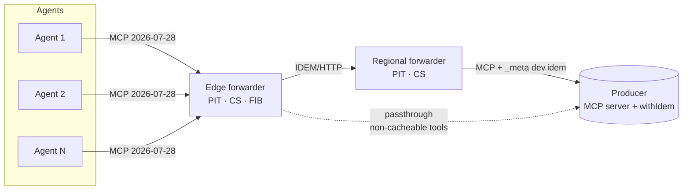

# 02 — Architecture

## 1. Overview



Minimum topology: agents → edge → producer. The tree topology (edge → regional → producer) exists for
the multi-hop experiments (E4).

## 2. Packages

| Package | Responsibility | Depends on | Runs in |
|---|---|---|---|
| `@idem/core` | names, canonicalization, JCS, digests, envelope, Ed25519, manifest, trust store, **forwarder engine** (PIT, CS, FIB), events, `Clock`, transport-agnostic `Producer` and consumer helpers (ADR-014) | Web APIs only | browser, Node, Vercel, simulator |
| `@idem/gateway` | IDEM over HTTP: producer handler, HTTP forwarder (edge/regional) with upstream HTTP faces, verifying `IdemClient`; Web-standard `(Request) => Promise<Response>` | core | browser (client), Node, Vercel |
| `@idem/mcp` | MCP binding (SDK v2): `createMcpProducer`, `createMcpEdge` (edge as a plain MCP endpoint), `IdemConsumer` | core, gateway, `@modelcontextprotocol/server` | Node, Vercel |
| `@idem/ndn` | native binding (protocol §9.2, ADR-026): IDEM name ⇄ NDN name, Interest/Data codec (content = JCS envelope with the IDEM signature), NDN Ed25519 via the NDNts keychain, `serveNdn` (wraps core's `Producer`), `NdnConsumer` (core's `buildInterest` + `verifyData`), TLV inspector. PIT/CS are NFD's | core, `@ndn/{packet,tlv,keychain,endpoint,fw}` | Node (Mini-NDN), browser (sandbox view; WebSocket face later) |
| `@idem/sim` | discrete-event simulator: topologies, links (delay, loss, bandwidth), workloads, metric collection | core | Node (experiments), browser (sandbox) |
| `apps/web` | landing, sandbox, docs, results, demo routes (producer + gateway) | all (`ndn` only for the sandbox's native view) | Vercel |

Dependency rule: `core` depends on nothing. `sim`, `gateway` and `ndn` only on `core` (plus `@ndn/*` for
`ndn`); `mcp` on `core` and `gateway`. Nothing depends on `apps/web`.

## 3. Forwarder engine (inside `@idem/core`)

The logic in protocol §7 lives **exactly once**, in `Forwarder`, parameterized by:

- `faces`: link abstraction (`Face.send(packet)`, `Face.onReceive`). The HTTP gateway, the simulator
  and the sandbox implement different faces; the engine is the same.
- `clock: Clock`: `RealClock` in production, `VirtualClock` in the simulator.
- `cs: ContentStore`: `MemoryContentStore` (byte-budgeted LRU) by default; the interface allows Redis.
- `verifier: Verifier` and `trust: TrustStore`.
- `onEvent: (e: ForwarderEvent) => void`: every §7 event becomes a typed object. **The sandbox and the
  experiments consume exactly this stream.** Metrics are not computed anywhere else.

```ts
type ForwarderEvent =
  | { t: number; node: string; kind: "interest_in"; name: string; face: string }
  | { t: number; node: string; kind: "cs_hit"; name: string; ageMs: number; face?: string }
  | { t: number; node: string; kind: "pit_aggregate"; name: string; waiting: number; face?: string }
  | { t: number; node: string; kind: "upstream_out"; name: string; nextHop: string; face?: string }
  | { t: number; node: string; kind: "data_in"; name: string; bytes: number }
  | { t: number; node: string; kind: "verify_ok" | "verify_fail"; name: string; us: number }
  | { t: number; node: string; kind: "cs_insert" | "cs_evict"; name: string; bytes: number }
  | { t: number; node: string; kind: "pit_satisfy"; name: string; faces: number }
  | { t: number; node: string; kind: "pit_expire" | "drop" | "bypass"; name?: string; reason?: string; face?: string };
```

`face` is the downstream face whose packet caused the event; the HTTP gateway uses it to return a
per-request `idem-trace`.

## 4. Flows

### 4.1 Miss with aggregation (3 agents request the same page at once)

```mermaid
sequenceDiagram
  participant A1 as Agent 1
  participant A2 as Agent 2
  participant A3 as Agent 3
  participant E as Edge (PIT/CS)
  participant P as Producer
  A1->>E: tools/call fetch_page(url)
  Note over E: canon → name N; CS miss; PIT creates N
  E->>P: tools/call + _meta.interest(N)
  A2->>E: tools/call fetch_page(equivalent URL)
  Note over E: same name N → PIT aggregates (2)
  A3->>E: tools/call fetch_page(url)
  Note over E: PIT aggregates (3)
  P-->>E: result + _meta.data(N, signature)
  Note over E: verify; CS insert; PIT satisfies 3 faces
  E-->>A1: result
  E-->>A2: result
  E-->>A3: result
```

### 4.2 Hit

```mermaid
sequenceDiagram
  participant A4 as Agent 4
  participant E as Edge
  A4->>E: tools/call fetch_page(url)
  Note over E: name N; CS hit (fresh)
  E-->>A4: result (signed Data, ageMs updated)
  Note over A4: IdemConsumer verifies signature
```

### 4.3 Side-effecting tool

`send_email` is not marked cacheable in the manifest → the edge does a plain MCP passthrough and emits `bypass`.

## 5. Where each piece runs in the deploy

| Component | Local | Vercel |
|---|---|---|
| Demo producer | `pnpm dev` (Next route) | Vercel Function `/api/producer/*` (IDEM HTTP + `/api/producer/mcp`) |
| Edge gateway | `pnpm dev` (Next route) | Vercel Functions `/api/edge/*` (IDEM HTTP) and `/api/mcp` (plain MCP) |
| Simulator + engine | browser | browser (sandbox: no server cost) |
| Experiments | local Node / Docker | — |

CS in the deploy: Fluid compute reuses instances, so `MemoryContentStore` is per instance. That is
enough for the demo and must be **stated in the UI**. A shared CS adapter (Redis via Vercel
Marketplace) is optional and off the critical path.
